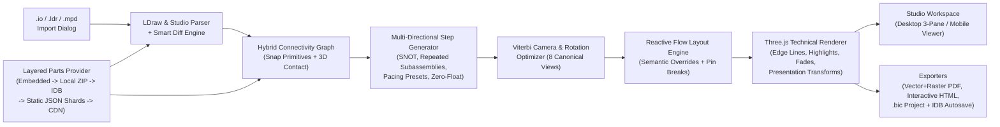

# Brick Instruction Creator — Architecture & Design Specification

## 1. Vision & Core Invariants

Brick Instruction Creator is a pure client-side TypeScript web application that transforms BrickLink Studio (`.io`) and LDraw (`.ldr` / `.mpd`) models into polished, publication-ready LEGO instruction manuals automatically—while giving builders complete non-destructive control over every visual and structural detail afterward.

### Core Design Invariants
1. **Zero Cascading Layout Corruption**: All visual, camera, callout, and presentation overrides bind to stable **semantic IDs** (`StepId`, `SubassemblyId`, `PartSignature`), never to page indices. Editing a piece or step on page 2 re-flows locally via constraint-based auto-packing and respects optional **Lock/Pin Page Break** boundaries without scrambling pages 3–199.
2. **Zero Floating Pieces**: Every generated step is backed by a verified physical attachment in the hybrid connectivity graph (studs, anti-studs, bars/rods, clips, Technic pins/axles, hinges, plus geometric contact tolerance). Multi-directional (SNOT) and cantilevered sections are automatically extracted into **subassembly callouts** built in their own natural orientation before attaching as rigid units. Physically separate components (e.g., minifigures, accessories) become independent build chapters; truly unattached parts are surfaced in an inspector warning panel.
3. **Optimal Automatic Camera & Rotations**: A global dynamic programming (Viterbi) optimizer selects discrete canonical isometric viewpoints (4 yaw 3/4 angles × top/bottom flip) across the entire step sequence, balancing new-part visibility/occlusion against rotation transition penalties and automatically placing rotation indicator icons whenever the viewpoint changes.
4. **Opinionated Defaults, Infinite Customization**: A 3-tier cascading styling system (**Theme Presets → Global Design Tokens → Per-Page/Per-Step Local Overrides**) produces official-quality manuals out of the box while enabling deep personalization of backgrounds, typography, step numbers, rotation icons, highlight outlines, fade-outs, placement arrows, piece previews (PLI), Bill of Materials (BOM), cover/back pages, and multi-step page layouts.
5. **Neocities-Ready Static Deployment**: 100% client-side SPA with relative asset paths (`base: './'`), strict per-file size compliance (`< 5 MB` per file via code-splitting and sharded `.json` part bundles), and only Neocities-allowed static file extensions (`.html`, `.js`, `.css`, `.json`, `.txt`, `.svg`, `.png`, `.woff2`, `.bin`).

---

## 2. System Architecture

### Tech Stack
- **Frontend**: React 19 + TypeScript + Vite + Tailwind CSS + Zustand (with Immer-style immutable updates & undo/redo history)
- **3D Rendering**: Three.js (orthographic technical camera, soft plastic toon/lambert shading, crisp LDraw edge/conditional lines, silhouette highlight outlines, previous-step desaturation/fade, offscreen canvas pool for PLI & step snapshots)
- **Compute Offloading**: Dedicated Web Worker pipeline architecture (clean pure-TS engine modules runnable in Workers or synchronously in tests)
- **Archive & Export**: `jszip` (`.io` archive + local `complete.zip` parsing), `jspdf` (hybrid vector layout + high-DPI 3D renders), self-contained single-file HTML viewer exporter
- **Persistence**: IndexedDB (`idb`) for project autosave & LDraw part geometry/snap cache + portable `.bic.json` project files

---

## 3. Core Data Model

### 3.1 Canonical Model (Immutable Source of Truth)
- `CanonicalModel`: Holds parsed `PartInstance[]`, `ExplicitSubmodel[]`, embedded custom LDraw `.dat` definitions, and metadata (title, author, source format).
- `PartInstance`:
  - `id`: Stable unique ID
  - `signature`: Spatial + partId + color hash (`${partId}:${color}:${quantizedPos}:${quantizedRot}`) used by **Smart Re-Import Diffing** to match unchanged bricks across Studio edits
  - `partId`: Normalized LDraw part identifier (e.g., `3001`, `3023`, `48729b`, `30374`)
  - `colorId`: LDraw color code (mapped to official RGB, finish, transparency)
  - `position`: `[x, y, z]` in LDraw Units (LDU; 1 stud = 20 LDU, 1 plate = 8 LDU, 1 brick = 24 LDU)
  - `rotation`: 3×3 rotation matrix (row-major)
  - `submodelPath`: Optional explicit submodel provenance
  - `originalStepIndex`: Optional pre-existing step index from `.io`/`.mpd`

### 3.2 Hybrid Connectivity Graph
- **Snap Connectors** (`SnapPoint`): Extracted from part definitions & LDraw primitives (`stud`, `anti_stud`, `bar`, `clip`, `pin`, `pin_hole`, `axle`, `axle_hole`, `hinge`, `ball`, `socket`, `side_stud`).
- **Connection Edge** (`ConnectionEdge`):
  - `a`, `b`: `PartInstance.id`
  - `type`: `'stud' | 'bar_clip' | 'technic' | 'hinge' | 'snot' | 'proximity'`
  - `strength`: Numeric mechanical strength weight
  - `direction`: World-space attachment normal vector (used for SNOT detection & exploded insertion arrows)
  - `toleranceGap`: Distance in LDU (flags loose Studio gaps within tolerance)
- **Connected Components**: Partitioned into build **Chapters** (sorted smallest accessory/minifigure first, largest main model last, or user-reordered). Singleton unattached parts outside snap tolerance generate non-blocking **Floating Part Warnings**.

### 3.3 Instruction Plan & Semantic Overrides
- `InstructionPlan`:
  - `chapters: BuildChapter[]`
  - `subassemblies: Record<SubassemblyId, SubassemblyNode>` — each stores its `buildOrientation` (canonical upright frame), `attachOrientation`, `repeatCount` (e.g., `2x`, `4x` for identical subassemblies), `attachTargetStepId`, and internal `steps: StepNode[]`.
  - `steps: Record<StepId, StepNode>` — each step owns `partIds`, `attachedSubassemblyIds`, computed `cameraView: CanonicalViewId`, `rotationFromPrevious`, and `calloutPlacement`.
- `StepOverride` (keyed by `StepId`, **never** page number):
  - `cameraViewOverride?: CanonicalViewId`
  - `customCameraAngles?: { azimuth: number; elevation: number }`
  - `layoutScale?: number`
  - `pinPageBreakBefore?: boolean`
  - `pageLayoutOverride?: PageLayoutTemplate` (`'1-up' | '2-up' | '3-up' | '4-up'`)
  - `presentationTransforms?: Record<PartIdOrSubassemblyId, PresentationTransform>`
    - `offset: [number, number, number]` (visual exploded offset in LDU)
    - `hingePivot?: [number, number, number]`
    - `hingeAxis?: [number, number, number]`
    - `hingeAngleDeg?: number` (temporary articulated pose for clarity)
    - `showArrow?: boolean`

---

## 4. Algorithms

### 4.1 Multi-Directional Step & Subassembly Generator
1. **Connectivity Construction**: Spatial hash broad-phase (`40 LDU` cells) + typed connector matching (stud↔anti-stud, bar↔clip, pin↔hole, axle↔axle-hole, hinge↔hinge) + geometric AABB/OBB contact fallback within configurable Studio tolerance (`2.5 LDU`).
2. **Component & Grounding Analysis**: Connected components become Chapters. Within each chapter, determine the base plane (lowest Y in LDraw Y-down or canonical Y-up coordinates) and build outward.
3. **SNOT & Cantilever Subassembly Extraction**:
   - Identify clusters of parts whose local "up" normal differs from global up (`|dot(localUp, globalUp)| < 0.7`) OR cantilevered clusters connected to the main body by a single cut-edge/hinge/clip/bar articulation.
   - Canonicalize each cluster into its own local upright `buildOrientation`.
   - Compute a structural isomorphism hash (`partId + color + relative transform`) across extracted clusters to collapse identical subassemblies (e.g., symmetric left/right wings, 4 wheels, 2 engine pods) into a single `SubassemblyNode` with `repeatCount = N`.
4. **Zero-Floating Topological Pacing**:
   - Maintain a frontier of parts physically connected to already-placed parts (plus grounded base parts at step 1).
   - Score candidates by height layer, same-part/color affinity, bilateral symmetry pairs, and mechanical support.
   - Group candidates into steps according to the active **Pacing Preset**:
     - **Kids / Beginner**: 1–3 pieces/step, max 2 unique part types
     - **Standard Official LEGO**: 3–6 pieces/step, symmetric pairs grouped, max 4 unique part types
     - **Adult / Compact**: 6–12 pieces/step, full-layer grouping
   - **Visibility Guard**: If newly grouped parts span opposing sides of the model such that no single canonical viewpoint sees ≥ 70% of new attachment points clearly, automatically split the step so every placement remains unobstructed.

### 4.2 Global Viterbi Camera & Rotation Optimizer
- **8 Canonical Viewpoints**:
  - Top 3/4 views: `FRONT_RIGHT (45°, 30°)`, `BACK_RIGHT (135°, 30°)`, `BACK_LEFT (225°, 30°)`, `FRONT_LEFT (315°, 30°)`
  - Underside flip views: `BOTTOM_FRONT_RIGHT (45°, -30°)`, `BOTTOM_BACK_RIGHT (135°, -30°)`, `BOTTOM_BACK_LEFT (225°, -30°)`, `BOTTOM_FRONT_LEFT (315°, -30°)`
- **Visibility Score** $V(t, v)$: For step $t$ and viewpoint $v$, evaluate projected visibility of each newly added part's centroid, bounding-box faces, and attachment normal against previously placed parts via analytical ray-box occlusion checks + normal alignment bonus.
- **Transition Cost** $T(u \to v)$:
  - Same view ($u = v$): `0`
  - 90° horizontal yaw turn: `0.35`
  - 180° horizontal turn: `0.55`
  - Flip top ↔ bottom: `1.10`
- **Dynamic Programming**: Solve
  $$\text{DP}[t][v] = \min_{u} \left( \text{DP}[t-1][u] + T(u \to v) \right) + (1 - V(t, v))$$
  (respecting any user `cameraViewOverride` as hard constraints), then backtrack the globally optimal viewpoint sequence. Whenever $v_t \neq v_{t-1}$, automatically attach a `RotationCue` (`yaw90CW`, `yaw90CCW`, `yaw180`, `flipVertical`) rendered as an official-style rotation icon on the step.

### 4.3 Reactive Flow Layout Engine & Smart Re-Import Diff
- **Constraint Auto-Packing**: Steps flow into pages based on active theme default layout (`1-up`, `2-up`, `3-up`, `4-up`) plus step complexity heuristics (steps with large subassembly callouts or >6 unique PLI items automatically promote to a larger slot).
- **Pin Page Breaks**: Users can toggle `Pin Page Break` on any step or section boundary. Edits before a pinned boundary absorb into pages within that section only, leaving all pages after the pin completely untouched.
- **Smart Re-Import Diff**: When re-importing a modified `.io`/`.ldr` file:
  1. Match incoming `PartInstance` records against existing parts by exact `signature`, then nearest-neighbor `(partId, colorId)` within `2 LDU`.
  2. Keep matched parts in their assigned `StepId`s (preserving all camera, highlight, layout, pin, and presentation overrides!).
  3. Remove deleted parts cleanly (collapsing empty steps only if desired).
  4. Insert newly added parts into the earliest physically connected step (or create a localized new step right where they connect) without touching downstream steps.

---

## 5. 3-Tier Customization System

1. **Tier 1 — Opinionated Theme Presets**:
   - `Classic LEGO Blue`: Crisp sky-blue gradient page canvas, bright white PLI boxes with subtle drop shadows, bold geometric step numbers, vivid cyan/yellow highlight outlines.
   - `Modern Clean White`: Warm gallery-white pages, light cool-slate PLI cards, ultra-clean dark charcoal typography, subtle blue/orange highlights.
   - `Dark Collector (18+)`: Deep matte obsidian-charcoal pages (like LEGO Icons/UCS manuals), warm metallic-gold accents, bright crisp rim highlights on new bricks.
   - `Technical Blueprint`: Prussian architectural blueprint background with fine drafting frame, crisp white technical lines, monospace dimension metadata.
2. **Tier 2 — Global Design Tokens**:
   - Page size (`Letter`, `A4`, `Square`), orientation (`Landscape`, `Portrait`), default steps-per-page (`Auto`, `1-up`, `2-up`, `3-up`, `4-up`)
   - Background style (solid color, linear gradient, subtle paper/dot texture, or custom uploaded image)
   - Typography (font family, step number scale & color, page number placement)
   - 3D Visuals: Highlight outline color & thickness for new parts, fade-out intensity & desaturation for previous-step parts, placement arrows toggle, rotation indicator style
   - PLI & BOM: PLI box position/background/border radius, BOM sort order (`Color → Part`, `Quantity`, `Part ID`) and columns
   - Cover & Back Pages: Title, subtitle, builder/author name, piece count badge, custom logo/image, hero 3D render angle, back-page completion summary
3. **Tier 3 — Local Page & Step Overrides**:
   - Per-step camera viewpoint, exploded visual offset (`X/Y/Z`), hinge pose angle, placement arrow toggle, submodel build-vs-attach toggle
   - Per-step `Pin Page Break` & `Page Layout Template` override (`1-up`–`4-up`)

---

## 6. Layered Neocities-Safe Parts Provider

To satisfy both zero-setup usability and Neocities static hosting rules (no `.dat`/`.zip` files in `dist/`, every deployed file strictly `< 5 MB`, relative paths):
1. **Layer 1 (In-Model Custom Parts)**: Subfiles and custom parts embedded inside `.io` or `.mpd` files.
2. **Layer 2 (User Local Library)**: Optional user-imported `complete.zip` or `.dat` files stored in browser IndexedDB.
3. **Layer 3 (IndexedDB Persistent Cache)**: Previously resolved LDraw geometry and snap metadata.
4. **Layer 4 (Self-Hosted Static JSON Shards)**: Sharded `/assets/ldraw-shards/shard-*.json` bundles (each `< 2 MB`, indexed by `manifest.json`) containing normalized geometry + snap points.
5. **Layer 5 (Built-in Procedural & Parametric Part Synthesizer + CDN Fallback)**: Built-in accurate parametric geometry + typed snap points for common bricks, plates, tiles, slopes, wedges, bars/rods, clips, hinges, Technic beams/pins, wheels, and minifigures—plus on-demand fetch fallback from a CORS-friendly official LDraw mirror for any exotic part ID.

---

## 7. Export Pipelines

- **PDF Export (`jspdf`)**: Renders crisp vector backgrounds, borders, PLI cards, step numbers, rotation SVGs, cover/back typography, and BOM tables combined with high-DPI WebGL 3D renders for every step and part preview.
- **Interactive HTML Viewer Export**: Generates a single self-contained `.html` file embedding the rendered manual data, step-by-step interactive viewer, parts checklists, BOM, and an interactive canvas/3D step inspector so builders can follow instructions on any phone, tablet, or desktop browser.
- **Project File (`.bic.json`) + IndexedDB Autosave**: Full lossless serialization of `CanonicalModel`, `InstructionPlan`, `ThemeSettings`, `StepOverrides`, and `Cover/Back` metadata.
