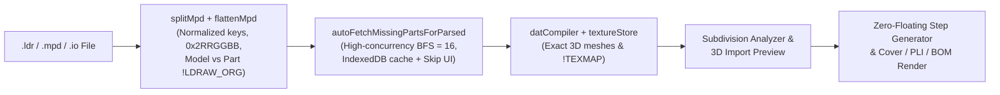

# LDraw (`.ldr` / `.mpd`) Automatic Import & Parts Resolution Design

## 1. Problem Statement

BrickLink Studio `.io` archives embed complete `.dat` geometry for every part in `model2.ldr`, whereas plain LDraw `.ldr` and `.mpd` files only reference external part IDs (e.g., `3029.dat`, `27448.dat`, `86210.dat`). Previously, importing `.ldr` / `.mpd` files suffered from several compounding failures:

1. **No automatic part fetching on import**: `.ldr` / `.mpd` files were parsed, analyzed for subdivision, previewed in 3D, and turned into steps *before* any `.dat` geometry was loaded. Missing parts fell back to `1×1` brick bounding boxes (e.g., `3029.dat` Plate 4×12 collapsed to 1×1) and catalog shapes fell back to solid rectangular boxes, producing dozens of Missing Shape errors, false Disconnected/Floating errors, broken subdivision cuts, and mangled renders.
2. **Stale & slow mirror fetching**: Manual fetching used an older April 2024 mirror at concurrency 6, sequentially probing `parts/`, `p/`, and `parts/s/` across duplicate mirrors on every 404.
3. **Printed official parts skipped when unprinted base was cached**: Checking fallback-matched cache entries prevented official printed parts (e.g., `3626cp01.dat`, `3069bp01.dat`) from being fetched whenever the unprinted base mold (`3626c`, `3069b`) was already loaded.
4. **MPD / LDR parser edge cases**:
   - Comment-only preambles before the first `0 FILE` were flushed as an empty root model.
   - Submodels declaring `0 !LDRAW_ORG Model` or `Unofficial_Model` were misclassified as single `.dat` parts instead of expanded submodels.
   - Backslash vs. forward-slash mismatches in `0 FILE` submodel references broke lookups.
   - Direct RGB hex colors (`0x2RRGGBB`) on type-1 lines parsed as `0` (Black), and common official LDConfig colors (such as `256` Rubber Black, `182` Trans-Bright Orange, `402` Reddish Orange, and Satin Trans finishes) triggered false unknown-color warnings.
   - `~Moved to <target>` redirect stubs and `=` alias prefixes leaked raw LDraw syntax into BOM/PLI part titles.
   - External `!TEXMAP` PNG textures and `0 !: 1 ...` subfile references inside `!TEXMAP` blocks were not fetched.

---

## 2. Architecture (`src/engine/ldrLibrary.ts` + `src/studioRuntime.ts`)

### 2.1 Automatic Pre-Analysis Fetching & Session Healing
- Immediately after `parseImportedModel(...)` in `fileInput.onchange` (and when reopening a saved `.ldr` / `.io` model in `restoreLastSessionOnStart()`), `autoFetchMissingPartsForParsed(parsed, displayName)` runs **before** `prepareSubdivisionData`, `analyzeModelSubdivisions`, `openImportAssistant`, and `buildManualFromParsed`.
- If all parts are already cached in IndexedDB (`partsLib`), the check finishes synchronously in milliseconds with zero UI flicker.
- If network downloads are needed, `#importFetchOverlay` displays live download progress (`Loaded N shapes (processed/total)`) plus a **Skip & Continue** button wired to an `AbortController`.
- Downloaded `.dat` files and `!TEXMAP` PNG textures (stored under `__tex__:<filename>`) are batch-persisted to IndexedDB so future imports are instant.
- If a restored model or manual **Fetch Online** / **Import .zip** adds missing shapes to a model with an active subdivision plan, `refreshSubdivisionPlanForParsed` re-evaluates the matching subdivision strategy against the real 3D bounding boxes.

### 2.2 Up-to-Date Official + Unofficial/Studio CORS Mirror Chain & Smart Failover
- Primary official mirror: `https://raw.githubusercontent.com/kulits/ldraw-parts/master/ldraw/` (daily-synced official LDraw `complete.zip`, including 2024–2026 updates, served via GitHub Fastly CDN with `Access-Control-Allow-Origin: *`).
- Independent official fallbacks: `https://mrubens.github.io/ldraw-library/`, `https://raw.githubusercontent.com/gkjohnson/ldraw-parts-library/master/complete/ldraw/`, and `https://cdn.jsdelivr.net/gh/kulits/ldraw-parts@master/ldraw/`.
- Unofficial & BrickLink Studio custom parts mirror: `https://raw.githubusercontent.com/iefierros/LegoMaster/main/ldraw/UnOfficial/` (`scope: 'unofficial'`), covering LDraw Unofficial parts (e.g., `35287.dat` + `s/35287s01.dat`), BrickLink Studio custom shapes (`bl_76925.dat`), and BrickLink assemblies (`bb892c01.dat`).
- **Scope-aware routing**: Studio custom IDs (`bl_*`, `*-bl`, `bb####`) and BrickLink-numbered *printed/decorated* IDs (`pb####`, `ps####`, `pat####`, `pr####` with 3+ digits, `*_torso`) route directly to `unofficial` / `custom` mirrors without wasting 404 probes on official LDraw mirrors (none of the ~25k official parts use these suffixes), while standard LDraw IDs check official mirrors first and fall through to `unofficial` when not yet official.
- **Printed Studio parts are fetched exactly first**: Many BrickLink-numbered prints are hosted as Studio `PE_TEX_INFO` decal parts on the UnOfficial mirror (e.g. minifig faces `3626cpb1965.dat`, `bl_3626cpb1211.dat` → `3626tex.dat`). `fetchLDrawDependencyGraph` always requests the exact printed ID; only if it 404s does `fetchDatFromMirrors` fall back to the unprinted base mold (`3626c`), stopping at the first fallback that is already cached so a blank base is never re-downloaded. The exact miss is recorded in the session `notFoundCache`, after which the BFS enqueues the base directly. (Previously these IDs short-circuited straight to the unprinted base, so minifigure heads imported from `.ldr` rendered faceless.)
- Mirrors share a `repoGroup` tag: a clean HTTP `404` skips duplicate mirrors of the same repository, whereas `403` / `429` / `5xx` / timeout / network errors transparently fail over to the next mirror.
- Candidate paths are ordered by LDraw directory conventions (`s/` → `parts/s/`, `48/`/`8/` → `p/`, Studio custom IDs → `parts/`, primitive prefixes → `p/` first, standard numeric parts → `parts/` only), eliminating wasted 404 probes.

### 2.3 Direct-Match BFS & `!TEXMAP` Support
- `fetchLDrawDependencyGraph` checks exact/direct cache membership (`getDirectLoadedDatLines`) rather than stripped fallbacks, ensuring official printed parts (`3626cp01`, `3069bp01`) are downloaded even when their unprinted base mold is already cached.
- `extractDatDependencies` scans both standard `1 ...` lines and `0 !: 1 ...` lines inside `!TEXMAP` blocks, skips primitives natively synthesized by `datCompiler.ts`, and queues external `parts/textures/*.png` files for download and `textureStore` pre-decoding.

### 2.4 Clean Metadata, MPD Parsing & Extended LDConfig Colors
- `hasMpdGeometryOrPartLines` skips comment-only preambles before the first `0 FILE`.
- `normalizeMpdSubfileKey` normalizes path separators, leading `./`, and casing for reliable submodel lookup.
- `isLDrawPartSubfile` treats `0 !LDRAW_ORG Model` / `Unofficial_Model` as submodels while keeping `Part` / `Subpart` / `Primitive` / `Shortcut` as embedded `.dat` parts.
- `extractCleanDatTitle` and `extractMovedToTarget` clean `=` alias prefixes, collapse repeated whitespace, and follow `~Moved to <target>` chains in `getHumanPartName`.
- `parseLDrawColorToken` and `resolveColorInfo` support direct RGB (`0x2RRGGBB`) plus expanded official LDConfig rubber, translucent, satin, metallic, and modern colors.

### 2.5 BrickLink Studio Part-Origin Corrections (`src/engine/studioPartOrigins.ts`)
- A few parts in BrickLink Studio's library use a different local origin than the LDraw library file we download for the same part number (Studio's mesh descends from LEGO Digital Designer; the LDraw author re-centered the part on its connection point). Studio writes its own origin into exported placement lines, so rendering with LDraw geometry shifts the part.
- `STUDIO_PART_ORIGIN_OFFSETS` stores, per part, the LDraw origin expressed in Studio's part-local LDraw frame; `parseLDrawSource` applies `P' = P + R · offset` to the leaf placement.
- Only applied when the source is Studio-authored (`.io`, or `.ldr`/`.mpd` containing Studio meta lines such as `0 FlexibleBrickControlPointUnitLength`, `0 NumOfBricks:`, `0 CustomBrick`, `0 FlexibleBrick:`, `PE_TEX_*`, `IsSubModel`) **and** the part geometry is not embedded in the file (embedded Studio geometry already matches Studio's origin).
- Current entries: `93091` *Figure Friends Handbag with Zipper* — Studio's origin is the bag base, LDraw's is the handle-bar axis 28.5 LDU above it. Verified against a Studio export where the uncorrected handle sat ~30 LDU from the hand; after correction the handle bar passes through the hand's grip center (< 1 LDU).

