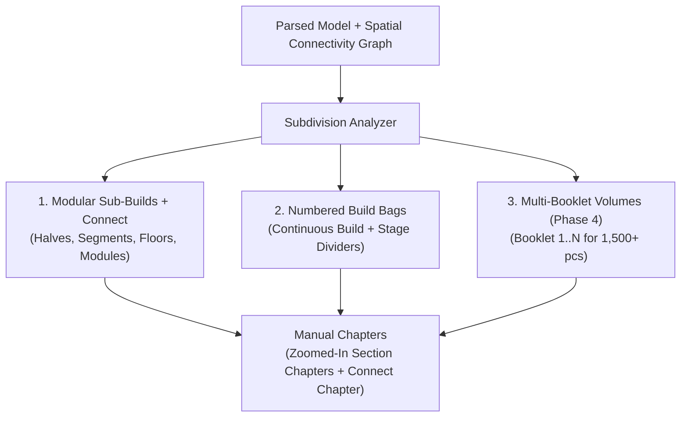

# Large & Elongated Model Subdivision — Design Specification

> **Status**: Phases 1–3 implemented in [`subdivisionAnalyzer.ts`](../src/engine/subdivisionAnalyzer.ts), [`studioRuntime.ts`](../src/studioRuntime.ts), and [`index.html`](../index.html). Phase 4 (Multi-Booklet PDF splitting & local-focus mini-locator) planned as follow-up.

---

## 1. Problem Statement & Motivation

A model does **not** need thousands of pieces to become hard to read in a monolithic step sequence—it can also be **"too big" spatially**.

For example, consider a long, narrow train chassis (e.g., 40–50 studs long, 4–6 studs wide) where an early step adds two buffer plates at opposite ends:
1. **Spatial Extent & Aspect Ratio Collapse**: Because the orthographic camera frames the entire assembled model, an elongated build (trains, ship hulls, bridges, starship fuselages, cranes) shrinks into a thin sliver—especially on portrait mobile screens—making small attachments hard to inspect.
2. **Far-End Symmetry Pairing**: Pairing identical parts from opposite ends of a long model into the same step forces the builder to inspect both far extremes at once.
3. **Subassembly Granularity Gap**: Small inline callouts work well for 2–20 piece pods, whereas a 100-piece half, wing, or modular floor should be built as its own zoomed-in multi-step chapter before connecting to the rest of the build.
4. **Large-Model Performance**: Naive $O(N^2)$ pair checks in connectivity construction and repeated AABB recomputation during visibility scoring degrade sharply on 1,000+ piece models.

**Why "Build Halves First, Then Connect" Works**: Splitting an elongated chassis into **Front Half + Rear Half** (or **`2×` Identical End Half** when symmetric) + a **Connect Halves & Finish** chapter cuts the active bounding length roughly in half during construction—making every brick **~2× larger (~4× the screen area)** on detail steps, and keeping center couplers/connectors cleanly grounded during final assembly.

### Design Goals
1. **Trigger on both Part Count *and* Physical Span / Readability**, so both high-piece-count models *and* long/wide models automatically receive tailored subdivision suggestions on import.
2. **Offer LEGO-native subdivision strategies**—**Build Halves / Segments First**, **Modular Floors**, **Structural Modules**, **Numbered Build Bags**, and **Baseplate Sectors**—with live 3D exploded previews that work seamlessly on **both mobile portrait and desktop**.
3. **Preserve all Core Design Invariants** from [`ARCHITECTURE.md`](./ARCHITECTURE.md): zero floating pieces, zero cascading layout corruption, optimal camera views, Smart Re-Import Diff compatibility, and 100% client-side Neocities static deployment.

---

## 2. Multi-Signal Trigger Thresholds

Rather than triggering solely on raw piece count, [`assessModelSubdivisionNeed`](../src/engine/subdivisionAnalyzer.ts) evaluates four geometric signals right after parsing:

| Signal | Condition | Why It Triggers |
| :--- | :--- | :--- |
| **Part Count** | `parts >= 350` | Prevents 150–400 step monolithic manuals and improves rendering speed. |
| **Physical Span** | Longest dimension `max(W, D, H) >= 560 LDU` (`≥ 28 studs`) | Keeps individual bricks legible inside the orthographic viewport. |
| **Elongated Aspect Ratio** | `longestAxis / medianAxis >= 3.0` **and** `longestAxis >= 360 LDU` (`≥ 18 studs`) | Catches trains, ships, bridges, wings, and fuselages where the model renders as a thin strip. |
| **Projected Readability Ratio** | `medianPartDiagonal / modelBoundingDiagonal < 0.045` (`parts >= 45`) | Directly detects when an average piece will render too small to read comfortably. |

### Behavior by Tier
- **Compact Models** (none triggered): Instant import (only opens the modal if explicit steps/submodels exist).
- **Borderline Models** (`150–349 parts` or `≥ 400 LDU` span): Imports immediately with a tip toast pointing to **Menu → Subdivide Model into Sections…**.
- **Large or Elongated Models** (any trigger above fires): Automatically opens the **Import & Subdivision Assistant** with ranked proposals, live 3D exploded preview, and a 1-click *"Keep as Single Continuous Build"* option.
- **Massive Models (`≥ 1,500 parts`)**: Flags the `massive` tier for future Multi-Booklet volume splitting.
- **Post-Import Re-Entry**: Accessible anytime from **Menu → Subdivide Model into Sections…** (fully backed by Undo and persisted in IndexedDB).

---

## 3. Subdivision Output Modes

1. **Modular Sub-Builds + Connect (`modular_chapters`)** — *Default when clean halves, floors, or structural cuts exist*
   - Each section is normalized to origin and built in its own dedicated chapter (`kind: 'submodel'`, `isSectionModule: true`), keeping the viewport tightly zoomed on just that section's bricks.
   - **Identical / Symmetric Collapse**: When two halves match structurally, users can toggle **`2×` Identical Halves** (build one chapter with a `×2` badge, then connect both copies) or build Front/Rear separately.
   - A **Connect Halves / Sections & Finish** chapter places/connects each completed section (showing its finished thumbnail in the PLI box) and then builds any spanning center coupler/bridge bricks on top.
2. **Numbered Build Bags (`numbered_bags`)** — *Universal continuous fallback*
   - Keeps one continuous build (Bag $k$ renders Bags $1 \dots k-1$ faded underneath via a shared `sectionId`), inserting official-style **Build Stage / Bag Divider Pages** (`kind: 'section_divider'`) before each bag with piece counts, step ranges, and a 3D stage preview (in both live view and PDF export).
3. **Multi-Booklet Volumes (`multi_booklet`, Phase 4)** — *Planned for 1,500+ piece models*
   - Groups chapters/bags into numbered booklets (`bookletIndex`) with per-booklet BOMs and separate PDF exports.

---

## 4. Subdivision Analysis Algorithms (`src/engine/subdivisionAnalyzer.ts`)

The pure-TypeScript analyzer evaluates five complementary LEGO-native strategies, scores each (`0–100`), and ranks the top proposals:

### Strategy A: Longitudinal Halves & Segments (`longitudinal_halves`)
*Best for elongated models (trains, ships, bridges, fuselages).*
1. **2D PCA Principal Horizontal Axis**: Computes the dominant lengthwise axis on horizontal XZ part centroids (snapping nearly orthogonal axes within ~5° to exact X or Z), so diagonal models split just as cleanly as axis-aligned ones.
2. **Minimum-Bridge Transverse Cut Sweep**: Sweeps candidate transverse cut planes around ideal split fractions (within `±14%` of length) to minimize spanning bricks, cut edges, and piece imbalance.
3. **Zero-Floating Spanning-Brick Assignment**: Bricks strictly on each side go to their respective half/segment; bricks straddling a cut plane (e.g., center coupler plates or tie-beams) go into a **Center Connector & Join** section. Any tiny fragments detached by a cut move to the Join section so every half stays 100% internally connected. If `> 35%` of parts span the cut, automatically falls back to `numbered_bags`.
4. **Identical Half Detection**: Compares part+color multisets and centroid-relative quantized distance profiles (invariant under 180° rotation and reflection) to detect `2×` identical halves.
5. **Zoom Gain Estimate**: Computes `fullDiagonal / maxSectionDiagonal` to show the expected zoom improvement (e.g., `~1.9× larger bricks per step`).

### Strategy B: Modular Floors & Vertical Layers (`horizontal_floors`)
*Best for modular buildings, towers, and multi-story structures (`spanY >= 72 LDU`).*
- Sweeps horizontal planes at plate resolution (`8 LDU`) to score cross-plane edges, spanning parts, and smooth-tile perimeter tops (`isTile`).
- Sharp local minima flanked by smooth tiles indicate detachable **Ground Floor / Floor N / Roof** modular seams (`modular_chapters`); tightly interlocked stacks produce vertical **Numbered Bags**.

### Strategy C: Structural Modules (`structural_modules`)
*Best for vehicles, spaceships, mechs, and multi-pod assemblies.*
- Uses farthest-point spatial seeding, balanced multi-source BFS growth along physical connections, and boundary modularity smoothing to isolate cohesive modules.

### Strategy D: Numbered Build Bags (`numbered_bags`)
*Universal fallback—valid on any model.*
- Runs a fast grounded bottom-up topological traversal and splits into balanced bags snapped to vertical height-layer transitions.

### Strategy E: Spatial Sectors / Baseplate Grid (`spatial_sectors`)
*Best for wide, flat dioramas and landscapes (`maxHoriz >= 480 LDU`, `minHoriz >= 240 LDU`).*
- Splits into `2×2` quadrants with seam-bridging bricks routed to a **Seam Join & Connectors** step.

### Interactive Refinement Helpers
- [`recomputeProposalWithCount`](../src/engine/subdivisionAnalyzer.ts): Re-partitions live when the user clicks `−` / `+` on the section count stepper or toggles `2×` collapse.
- [`mergeProposedSections`](../src/engine/subdivisionAnalyzer.ts): Combines two adjacent sections without dropping parts.
- [`splitProposedSection`](../src/engine/subdivisionAnalyzer.ts): Bisects a single oversized section along its own 2D PCA axis.

---

## 5. Companion Readability Safeguards

1. **Spatial Spread Guard**: In [`stepGenerator.ts`](../src/engine/stepGenerator.ts) and [`studioRuntime.ts`](../src/studioRuntime.ts), candidate grouping enforces a maximum 3D distance (`220 LDU` in `stepGenerator.ts`; `120 LDU` on elongated models `≥ 400 LDU` in `studioRuntime.ts`) so opposite-end pieces aren't lumped into one step.
2. **Local Detail Framing (Phase 4)**: Optional auto-zoom with a subtle full-model silhouette locator inset for single-end detail steps after halves are connected.

---

## 6. Mobile-First & Desktop UX

The upgraded `#importModal` in [`index.html`](../index.html) adapts automatically to screen size:
- **Mobile Portrait (`< lg`)**: Full-height bottom sheet with a touch-orbitable 3D exploded preview (`30vh`) + Explode slider pinned at the top, scrollable proposal cards and section controls below, and a sticky **Generate Manual** footer.
- **Desktop (`lg+`)**: Responsive 2-pane modal (`max-w-4xl`) with the 3D preview on the left and ranked proposals + customization on the right.

### Live 3D Preview Controls
- **Orbit**: 1-finger touch drag or mouse drag directly on the WebGL canvas (`WebGLBrickEngine`), reusing uploaded GPU buffers with zero re-uploads while orbiting.
- **Explode Slider (`0%–100%`)**: Translates each section outward along its computed `explodeOffset` vector (pulling halves apart horizontally, lifting center couplers upward, lifting modular floors vertically, or separating quadrants diagonally).
- **Color Mode Toggle**: Switch between colorblind-safe **Section Colors** and true **Brick Colors** (tapping any section row dims all other sections to highlight it).
- **Section Customization**: Toggle **Build & Connect** vs. **Numbered Bags**, adjust section count (`−` / `+`), toggle **2× Identical Halves**, rename sections inline, and 1-click **Split** or **Merge ↓**.

---

## 7. Performance Upgrades

1. **3D Spatial Hash Broad-Phase**: Replaced $O(N^2)$ pair loops in [`buildConnectivityGraph`](../src/engine/connectivity.ts) and [`buildSpatialAdjacency`](../src/studioRuntime.ts) with an `80 LDU` uniform 3D spatial hash grid (plus oversized-part fallback), preserving exact physical contact and smooth side-wall grazing rejection (`sideCaps`).
2. **Precomputed World AABB Cache**: [`computeAllPartWorldAabbs`](../src/engine/connectivity.ts) and cached AABB maps in [`cameraOptimizer.ts`](../src/engine/cameraOptimizer.ts) and [`stepGenerator.ts`](../src/engine/stepGenerator.ts) eliminate redundant 8-corner transforms during visibility checks.
3. **Benchmark**: Verified in [`subdivision.test.ts`](../src/engine/__tests__/subdivision.test.ts) — parsing, spatial connectivity, and full subdivision analysis of a 1,000-part model completes in `~330 ms`.

---

## 8. Implementation Phases

| Phase | Scope | Status |
| :--- | :--- | :--- |
| **Phase 1: Engine Perf + Spread Guard** | Spatial hash broad-phase in `connectivity.ts` & `studioRuntime.ts`; precomputed AABB cache; spatial spread guard; 1,000-part benchmark test. | **Implemented** |
| **Phase 2: Subdivision Analyzer & Join Chapters** | `subdivisionAnalyzer.ts` (5 strategies + 2D PCA + `2×` symmetry + Merge/Split); `modular_chapters` & `numbered_bags` execution; `section_divider` pages in live view & PDF export. | **Implemented** |
| **Phase 3: Mobile & Desktop 3D Import Assistant** | Responsive `#importModal` with live exploded 3D WebGL preview, touch/mouse orbit, color modes, granularity stepper, inline rename/merge/split, Menu re-entry, Undo & IndexedDB persistence. | **Implemented** |
| **Phase 4: Multi-Booklet Export & Local-Focus Zoom** | Separate PDF booklet volumes for 1,500+ piece models; optional auto-zoom with mini-locator silhouette inset for post-join detail steps. | **Planned** |
