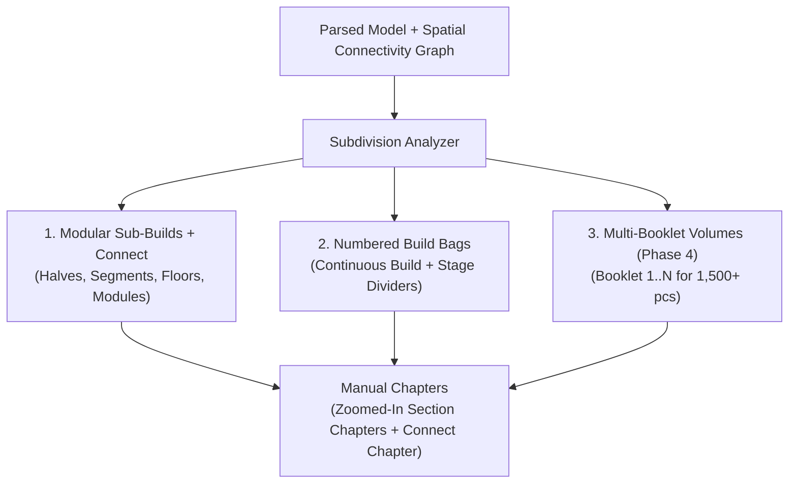

# Large & Elongated Model Subdivision — Design Specification

> **Status**: Phases 1–3 implemented in [`subdivisionAnalyzer.ts`](../src/engine/subdivisionAnalyzer.ts), [`studioRuntime.ts`](../src/studioRuntime.ts), and [`index.html`](../index.html). Phase 4 (Multi-Booklet PDF splitting & local-focus mini-locator) planned as follow-up.

---

## 1. Problem Statement & Motivation

A model does **not** need thousands of pieces to become hard to read in a monolithic step sequence—it can also be **"too big" spatially**.

For example, consider a long, narrow train chassis (e.g., 40–50 studs long, 4–6 studs wide) where an early step adds two buffer plates at opposite ends:
1. **Spatial Extent & Aspect Ratio Collapse**: Because the orthographic camera frames the entire assembled model, an elongated build (trains, ship hulls, bridges, starship fuselages, cranes) shrinks into a thin sliver—especially on portrait mobile screens—making small attachments hard to inspect.
2. **Far-End Symmetry Pairing**: Pairing identical parts from opposite ends of a long model into the same step forces the builder to inspect both far extremes at once.
3. **Subassembly Granularity Gap**: Small inline callouts work well for 2–20 piece pods, whereas a 100-piece half, wing, or modular floor should be built as its own zoomed-in multi-step chapter before connecting to the rest of the build.
4. **Large-Model Performance**: Naive $O(N^2)$ pair checks in connectivity construction and repeated AABB recomputation during visibility scoring degrade sharply on 1,000+ piece models.

**Why "Build Halves First, Then Connect" Works**: Splitting an elongated chassis into **Front Half + Rear Half** (or **`2×` Identical End Half** when symmetric) + a **Connect Halves & Finish** chapter cuts the active bounding length roughly in half during construction—making every brick **~2× larger (~4× the screen area)** on detail steps, and keeping center couplers/connectors cleanly grounded during final assembly.

### Design Goals
1. **Trigger on both Part Count *and* Physical Span / Readability**, so both high-piece-count models *and* long/wide models automatically receive tailored subdivision suggestions on import.
2. **Offer LEGO-native subdivision strategies**—**Build Halves / Segments First**, **Modular Floors**, **Structural Modules**, **Numbered Build Bags**, **Footprint Quadrants**, and **Split by Baseplate**—with live 3D exploded previews that work seamlessly on **both mobile portrait and desktop**.
3. **Preserve all Core Design Invariants** from [`ARCHITECTURE.md`](./ARCHITECTURE.md): zero floating pieces, zero cascading layout corruption, optimal camera views, Smart Re-Import Diff compatibility, and 100% client-side Neocities static deployment.

---

## 2. Multi-Signal Trigger Thresholds

Rather than triggering solely on raw piece count, [`assessModelSubdivisionNeed`](../src/engine/subdivisionAnalyzer.ts) evaluates four geometric signals right after parsing:

| Signal | Condition | Why It Triggers |
| :--- | :--- | :--- |
| **Part Count** | `parts >= 350` | Prevents 150–400 step monolithic manuals and improves rendering speed. |
| **Physical Span** | Longest dimension `max(W, D, H) >= 560 LDU` (`≥ 28 studs`) | Keeps individual bricks legible inside the orthographic viewport. |
| **Elongated Aspect Ratio** | `longestAxis / medianAxis >= 3.0` **and** `longestAxis >= 360 LDU` (`≥ 18 studs`) | Catches trains, ships, bridges, wings, and fuselages where the model renders as a thin strip. |
| **Projected Readability Ratio** | `medianPartDiagonal / modelBoundingDiagonal < 0.045` (`parts >= 45`) | Directly detects when an average piece will render too small to read comfortably. |

### Behavior by Tier
- **Compact Models** (none triggered): Instant import (only opens the modal if explicit steps/submodels exist).
- **Borderline Models** (`150–349 parts` or `≥ 400 LDU` span): Imports immediately with a tip toast pointing to **Menu → Subdivide Model into Sections…**.
- **Large or Elongated Models** (any trigger above fires): Automatically opens the **Import & Subdivision Assistant** with ranked proposals, live 3D exploded preview, and a 1-click *"Keep as Single Continuous Build"* option.
- **Massive Models (`≥ 1,500 parts`)**: Flags the `massive` tier for future Multi-Booklet volume splitting.
- **Post-Import Re-Entry**: Accessible anytime from **Menu → Subdivide Model into Sections…** (fully backed by Undo and persisted in IndexedDB).

---

## 3. Subdivision Output Modes

1. **Modular Sub-Builds + Connect (`modular_chapters`)** — *Default when clean halves, floors, or structural cuts exist*
   - Each section is normalized to origin and built in its own dedicated chapter (`kind: 'submodel'`, `isSectionModule: true`), keeping the viewport tightly zoomed on just that section's bricks.
   - **Identical / Symmetric Collapse**: When two halves match structurally, users can toggle **`2×` Identical Halves** (build one chapter with a `×2` badge, then connect both copies) or build Front/Rear separately.
   - A **Connect Halves / Sections & Finish** chapter places/connects each completed section (showing its finished thumbnail in the PLI box) and then builds any spanning center coupler/bridge bricks on top.
2. **Numbered Build Bags (`numbered_bags`)** — *Universal continuous fallback*
   - Keeps one continuous build (Bag $k$ renders Bags $1 \dots k-1$ faded underneath via a shared `sectionId`), inserting official-style **Build Stage / Bag Divider Pages** (`kind: 'section_divider'`) before each bag with piece counts, step ranges, and a 3D stage preview (in both live view and PDF export).
3. **Multi-Booklet Volumes (`multi_booklet`, Phase 4)** — *Planned for 1,500+ piece models*
   - Groups chapters/bags into numbered booklets (`bookletIndex`) with per-booklet BOMs and separate PDF exports.

---

## 4. Subdivision Analysis Algorithms (`src/engine/subdivisionAnalyzer.ts`)

The pure-TypeScript analyzer evaluates five complementary LEGO-native strategies, scores each (`0–100`), and ranks the top proposals—enforcing a **strict zero-floating invariant** across every section of every proposal while slicing along **model-agnostic LEGO connection strengths**:

> **Zero-Floating Section Invariant** (verified by [`verifyProposalZeroFloating`](../src/engine/subdivisionAnalyzer.ts)):
> Every proposed section (and every copy inside `repeatPartIndexGroups`, plus any optional articulated `Center Joint & Bogie` or symmetric `Center Connector`) MUST be a **single connected component** in the physical adjacency graph (`isConnectedSubgraph === true`). No section may contain floating parts, detached roof chunks, or scattered debris.

### 4.1 General LEGO Connection-Strength Graph (Model-Agnostic)

Rather than relying on model-specific heuristics (such as train-only rules), subdivision slicing is driven from first principles by [`classifyConnectionEdge`](../src/engine/subdivisionAnalyzer.ts) and [`buildTypedConnectionGraph`](../src/engine/subdivisionAnalyzer.ts), which classify every physical contact into **Strong**, **Weak**, or **None**:

| Connection Type | Kind | Strength | Physical Meaning & Slicing Behavior |
| :--- | :--- | :--- | :--- |
| **Stud-to-Anti-Stud / SNOT** | `stud` | **Strong** | Rigid clutch power; keeps brick assemblies together unless explicitly cut. |
| **Technic Axle through Cross (`+`) Hole** | `axle_cross` | **Strong** | Torsionally locked (cross-axle collars `4032`/`3941`, bushes `3713`, gears, axle-mounted wheels `50254`, or embedded `axlehol` parts). |
| **Wheel ↔ Wheel Holder / Rigid Pin** | `wheel_mount`, `rigid_pin` | **Strong** | Direct wheel-holder mounts and rigid Technic pin joins stay intact. |
| **Technic Axle through Round Hole** | `axle_round` | **Weak** | Free-spinning pivot (pinhole plates `3176`, Technic bricks `3700`, beams); natural slicing seam. |
| **Clips, Bars, Hinges, Turntables, Swivels** | `clip_hinge` | **Weak** | Articulated/hinged joints and opposing pinhole coupler tongues; natural slicing seam. |
| **Piece Resting on Smooth Tile** | `tile_rest` | **Weak** | No vertical clutch power; upper assembly lifts off cleanly. |
| **Tile-Majority Mixed Seam** | `tile_seam` | **Weak** | When a horizontal seam mixes smooth tiles (or jumper plates) and minimal anchor studs, **prefer the majority**: if smooth tile contact area strictly exceeds stud contact area (`tileArea > studArea`), downgrade the minimal anchor stud edges to weak `tile_seam` edges and tag the upper assembly as a detachable cap (`isDetachableCap: true`, e.g., removable vehicle/train roofs, hatches, or modular building floors). Conversely, if studs are the majority (`studArea >= tileArea`), keep the upper assembly rigidly attached. |
| **Concave Hollow / Smooth Side Grazing** | `none` | **None** | Rejects false AABB overlaps inside concave scoops (`30562`) and side-by-side non-SNOT grazing. |

**Cohesive Strong-Group Leaf Absorption**: [`buildCohesiveStrongGroups`](../src/engine/subdivisionAnalyzer.ts) extracts connected components of strong edges and iteratively folds small degree-1 leaf components into their unique weak-graph neighbor (e.g., wheel+axle pairs into a bogie frame, clip-on doors into a cabin, or a bogie/end-assembly onto its central pivot axle) while **preserving** significant tile-majority detachable caps (`≥ 6` parts) and major body halves.

### 4.2 Core Primitive: Anchored Connected Graph Partitioner (`enforceConnectedPartition`)
1. **Per-Component Partitioning**: Extracts global connected components first so genuinely separate builds (e.g., a train and a separate trackside platform `> 16 LDU` away) stay in their own standalone connected sections instead of floating inside another section. Small CAD-clearance sub-assemblies (`≤ 16` parts within `12 LDU` in [`buildSpatialAdjacency`](../src/studioRuntime.ts)) are bridged beforehand so bogies, pantographs, headlights, and mirrors remain attached to the model.
2. **Locked Connected Cores**: For each spatial bucket, locks its largest connected component as an anchored core.
3. **Priority Frontier Expansion**: Claims all remaining/detached bricks strictly across physical `adjacency` edges into an already-connected core (weighted by spatial fidelity, shared-edge strength, and balance), inductively guaranteeing 100% single-component connectivity at every step.
4. **Articulation-Guarded Boundary Smoothing**: Moves boundary bricks to an adjacent section with stronger physical attachment **only** when an early-exit BFS cut-vertex check (`wouldStayConnectedWithout`) confirms removing the brick does not split its current section.

### Strategy A: Longitudinal Halves & Segments (`longitudinal_halves`)
*Best for elongated models (trains, light rail vehicles, articulated vehicles, ships, bridges, fuselages).*
1. **2D PCA Principal Horizontal Axis**: Computes the dominant lengthwise axis on horizontal XZ part centroids (snapping nearly orthogonal axes within ~5° to exact X or Z), so diagonal models split just as cleanly as axis-aligned ones.
2. **Minimum-Strong-Cut Transverse Sweep**: Sweeps candidate transverse cut planes around ideal split fractions (within `±14%` of length) minimizing strong-edge cuts (without penalizing compact articulated seam hubs) and snapping onto a vertical Technic pivot rod when one sits in the seam window.
3. **Whole Strong-Group Partitioning, Zero-Floating Enforcement & Detachable Roofs/Caps**:
   - **Removable Roofs / Caps** (`isDetachableCap: true`): Tile-majority upper assemblies (e.g., **Front Roof** and **Rear Roof** resting on mostly smooth tiles with minimal anchor studs) are automatically paired with their parent half, lifted upward in the 3D exploded preview, built in their own zoomed-in chapter, and lowered onto the model **after** minifigures are placed inside.
   - **Stud-Owned Seam Parts**: Entire strong body groups—including curved scoops and round-hole coupler tongues protruding slightly past the cut plane—stay intact on their corresponding half.
   - **Articulated Joint Isolation**: Only compact intact seam hubs bridging the halves (e.g., vertical Technic pivot rod + coaxial cross-axle circular pieces + any intact end assembly such as a middle bogie or pivot hub) go into the Center Join section when they form a single connected assembly. For articulated axle joints, [`buildManualFromParsed`](../src/studioRuntime.ts) builds any multi-part end assembly as its own zoomed-in chapter and sequences **Connect Halves & Finish** in physical assembly order with 3D directional arrows and step badges:
     1. **Place** First Half
     2. **Drop into cavity** — floating circular cross-axle pieces positioned inside the seam cavity
     3. **Slide halves together** — Second Half slides in around the center pieces
     4. **Push rod through** — vertical Technic axle with 1:1 actual-size guide
     5. **Attach end assembly to rod** — pre-built end assembly (e.g., Middle Bogie) pushes onto the protruding bottom or top end of the axle (`endAttachSide`)
     6. **Place minifigures**, then **Snap on removable roofs/caps** from above
   - **General Solid / Multi-Segment Splits**: For solid monolithic models without weak joints (or `3–6` segment splits), runs `enforceConnectedPartition` directly on the primary connected component with **no floating Join debris cloud** so every segment (`Front Section`, `Middle Section`, `Rear Section`) is a solid, single-connected-component build that snaps directly onto its neighbor.
4. **Identical Half Detection (`2×` Collapse)**: Compares part+color multisets and centroid-relative quantized distance profiles (invariant under 180° rotation and reflection) to detect `2×` identical halves. Only emits a separate `Center Connector` when both halves match **and** the center connector itself is a single connected component touching both halves.
5. **Zoom Gain Estimate**: Computes `fullDiagonal / maxSectionDiagonal` to show the expected zoom improvement (e.g., `~2.3× larger bricks per step`).

### Strategy B: Modular Floors & Vertical Layers (`horizontal_floors`)
*Best for modular buildings, towers, and multi-story structures (`spanY >= 72 LDU`).*
- Sweeps horizontal planes at plate resolution (`8 LDU`) to score cross-plane edges, spanning parts, and smooth-tile perimeter tops (`isTile`), then runs `enforceConnectedPartition` so every floor is 100% internally connected.
- Sharp local minima flanked by smooth tiles indicate detachable **Ground Floor / Floor N / Roof** modular seams (`modular_chapters`); tightly interlocked stacks produce vertical **Numbered Bags**.

### Strategy C: Structural Modules (`structural_modules`)
*Best for vehicles, spaceships, mechs, and multi-pod assemblies.*
- **Natural Weak-Joint Fast Path**: When the general Typed Connection-Strength Graph (clips, hinges, round-hole axles, and tile-majority seams) naturally separates a model into `2–8` cohesive, single-connected-component strong modules, uses those exact LEGO seams directly without cutting through any strong stud cluster.
- **Graph-Clustering Fallback**: For tightly stud-welded models, uses farthest-point spatial seeding inside the primary connected component, balanced multi-source BFS growth along physical connections, and articulation-guarded boundary modularity smoothing (`wouldStayConnectedWithout`) to isolate cohesive, 100% connected modules ordered in a grounded contact sequence.

### Strategy D: Numbered Build Bags (`numbered_bags`)
*Universal fallback—valid on any model.*
- Runs a spatially cohesive bottom-up grounded traversal, enforces per-bag single-component connectivity via `enforceConnectedPartition`, and orders bags via `orderConnectedSections` so **both** each individual bag **and** every cumulative prefix (`Bag 1 … Bag m`) are 100% connected.

### Strategy E: Footprint Quadrants (`spatial_sectors`)
*Best for wide, flat dioramas and landscapes (`maxHoriz >= 480 LDU`, `minHoriz >= 240 LDU`).*
- Splits into `2×2` connected quadrants via `enforceConnectedPartition` with zero floating seam parts.
- Shown in the wizard as **Footprint Quadrants (N Sectors)** (formerly "Baseplate Sectors"; renamed so it is not confused with Strategy F, which follows real baseplates).

### Strategy F: Split by Baseplate (`baseplates`)
*Best for MILS modules, modular buildings on 16×32 baseplates, city/train layouts, and any model built across several baseplates.*
- **Baseplate detection** ([`detectGroundBaseplates`](../src/engine/subdivisionAnalyzer.ts)): a part is a candidate if it is thin (`≤ 14 LDU` incl. studs) **and** either has a known baseplate ID (`3811`, `3867`, `3857`, `4186`, `10701`, road plates `44336`/`44341`/`44342`/`44343`), has "Baseplate" in its name, or spans `≥ 300 LDU` (~16×16 studs) in both horizontal directions (large plates used as bases).
- **Ground-level only**: candidates must sit within `12 LDU` of the model's lowest point, so large plates used as upper floors are ignored. A candidate whose footprint is ≥ 50% covered by a larger ground baseplate is dropped (e.g. a 16×16 plate resting on a 32×32 baseplate).
- **Offered when ≥ 2 ground baseplates exist**, always included in the wizard list (never trimmed by the top-4 ranking) with confidence `93`, so it is usually the recommended option for multi-baseplate models.
- **Assignment** ([`buildBaseplateSplitProposal`](../src/engine/subdivisionAnalyzer.ts)): every part gets a footprint bucket (smallest baseplate containing its XZ center, else the nearest footprint). Per connected component: a component with one baseplate goes wholly to it; with several, each baseplate first grows (BFS) across physically connected parts in its own bucket, then leftover parts (only reachable through a neighbor's build, e.g. a bridge across the seam) are claimed by an adjacent section—preferring their own bucket—so **every section stays one connected piece** (zero floating parts). Components without any baseplate become standalone *Separate Assembly* sections.
- **Output**: `modular_chapters`, one section per baseplate named `Baseplate N (W×L)`, numbered in reading order along the layout's long axis, exploding horizontally away from the layout center in the preview.

### Interactive Refinement Helpers
- [`recomputeProposalWithCount`](../src/engine/subdivisionAnalyzer.ts): Re-partitions live when the user clicks `−` / `+` on the section count stepper or toggles `2×` collapse.
- [`mergeProposedSections`](../src/engine/subdivisionAnalyzer.ts): Combines two physically touching sections (`sectionsShareEdge`), refusing merges that would create disconnected floating parts.
- [`splitProposedSection`](../src/engine/subdivisionAnalyzer.ts): Bisects a single oversized section along its own 2D PCA axis using `enforceConnectedPartition` so both resulting halves remain 100% connected.

---

## 5. Companion Readability Safeguards

1. **Spatial Spread Guard**: In [`stepGenerator.ts`](../src/engine/stepGenerator.ts) and [`studioRuntime.ts`](../src/studioRuntime.ts), candidate grouping enforces a maximum 3D distance (`220 LDU` in `stepGenerator.ts`; `120 LDU` on elongated models `≥ 400 LDU` in `studioRuntime.ts`) so opposite-end pieces aren't lumped into one step.
2. **Contact-Ordered Final Assembly**: In `Connect Sections & Finish` ([`studioRuntime.ts`](../src/studioRuntime.ts)), completed sections attach strictly in physical-contact order (attaching any bridging `Center Connector` onto Half #1 before connecting Half #2 when halves do not touch directly) so no section ever floats during final assembly.
3. **Local Detail Framing (Phase 4)**: Optional auto-zoom with a subtle full-model silhouette locator inset for single-end detail steps after halves are connected.

---

## 6. Mobile-First & Desktop UX

The upgraded `#importModal` in [`index.html`](../index.html) adapts automatically to screen size:
- **Mobile Portrait (`< lg`)**: Full-height bottom sheet with a touch-orbitable 3D exploded preview (`32vh`), scrollable proposal cards below, and a sticky **Generate Manual** footer.
- **Desktop (`lg+`)**: Responsive 2-pane modal (`max-w-4xl`) with the 3D preview on the left and ranked proposals on the right.

### Live 3D Preview Controls & Proposal Curation
- **Orbit**: 1-finger touch drag or mouse drag directly on the WebGL canvas (`WebGLBrickEngine`), reusing uploaded GPU buffers with zero re-uploads while orbiting.
- **Always-Visible Overlay Icons**: Subtle circular overlay icon buttons sit in the top-right corner of the 3D preview whenever a multi-section proposal is selected:
  - **Animated Explode Toggle**: Binary exploded/assembled toggle that smoothly eases (`340 ms` cubic ease-in-out) each connected section outward along its computed `explodeOffset` vector (and collapses back cleanly). Whole-minifigure assemblies (via `extractMinifigureGroups`) ride with their host section.
  - **Color Mode Toggle**: Switches between colorblind-safe **Section Colors** and true **Part Colors**.
- **Curated Wizard Proposals**: `analyzeModelSubdivisions()` offers **2-Half Longitudinal Splits**, **Horizontal Floors**, **Footprint Quadrants**, **Natural Sub-Assemblies / Structural Modules**, and **Split by Baseplate** (alongside **Single Continuous Build**). Arbitrary 3-segment longitudinal splits and random Numbered Build Bags are excluded from wizard proposals, and confusing `~N× zoom` / redundant header chips are omitted.

### Build Organization Picker
The proposal chooser is a custom, theme-matched listbox (`#impProposalPicker`, rendered by `renderImportProposalPicker()` in [`studioRuntime.ts`](../src/studioRuntime.ts)) instead of a native `<select>` plus a separate description box:
- **Trigger card** shows the selected option's title, *Recommended* badge, description, and per-section chips with their preview color and an explicit part count (e.g. `Front Half · 1,169 parts`, `×2 · 210 parts each` for collapsed identical halves).
- **Options expand inline** below the trigger (no popover clipping inside the scrollable pane or mobile sheet). Each option includes its title, badge, description, and a summary line (`2 sections · 1,718 parts`), with a checkmark on the current choice.
- **Accessibility**: `aria-haspopup="listbox"` / `aria-expanded` trigger, `role="listbox"` + `role="option"` + `aria-activedescendant`; ↑/↓/Home/End to move, Enter/Space to choose, Esc to close, Tab or tapping outside to dismiss.

*(Note: The former "Customize Sections" inline split/merge/count-stepper panel and persistent bottom explode slider bar were intentionally removed to keep the Import Assistant clean and unobtrusive.)*

---

## 7. Performance Upgrades

1. **3D Spatial Hash Broad-Phase**: Replaced $O(N^2)$ pair loops in [`buildConnectivityGraph`](../src/engine/connectivity.ts) and [`buildSpatialAdjacency`](../src/studioRuntime.ts) with an `80 LDU` uniform 3D spatial hash grid (plus oversized-part fallback), preserving exact physical contact and smooth side-wall grazing rejection (`sideCaps`).
2. **Precomputed World AABB Cache**: [`computeAllPartWorldAabbs`](../src/engine/connectivity.ts) and cached AABB maps in [`cameraOptimizer.ts`](../src/engine/cameraOptimizer.ts) and [`stepGenerator.ts`](../src/engine/stepGenerator.ts) eliminate redundant 8-corner transforms during visibility checks.
3. **Benchmark**: Verified in [`subdivision.test.ts`](../src/engine/__tests__/subdivision.test.ts) — parsing, spatial connectivity, and full subdivision analysis of a 1,000-part model completes in `~330 ms`.

---

## 8. Implementation Phases

| Phase | Scope | Status |
| :--- | :--- | :--- |
| **Phase 1: Engine Perf + Spread Guard** | Spatial hash broad-phase in `connectivity.ts` & `studioRuntime.ts`; precomputed AABB cache; spatial spread guard; 1,000-part benchmark test. | **Implemented** |
| **Phase 2: Subdivision Analyzer & Join Chapters** | `subdivisionAnalyzer.ts` (6 strategies incl. Split by Baseplate + 2D PCA + `2×` symmetry); `modular_chapters` & `numbered_bags` execution; `section_divider` pages in live view & PDF export. | **Implemented** |
| **Phase 3: Mobile & Desktop 3D Import Assistant** | Responsive `#importModal` with live exploded 3D WebGL preview, touch/mouse orbit, color modes, ranked proposal cards, Menu re-entry, Undo & IndexedDB persistence. | **Implemented** |
| **Phase 4: Multi-Booklet Export & Local-Focus Zoom** | Separate PDF booklet volumes for 1,500+ piece models; optional auto-zoom with mini-locator silhouette inset for post-join detail steps. | **Planned** |
