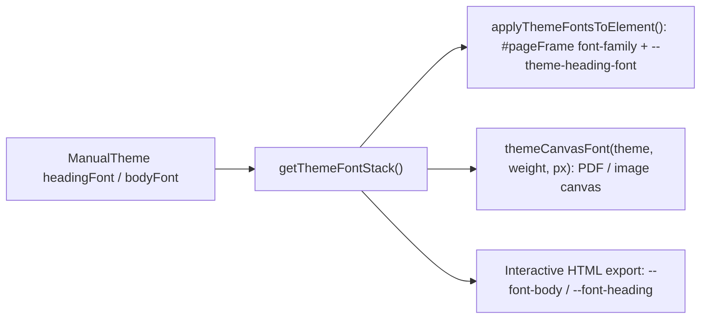

# Customizable Theme Fonts Design

Custom themes can now set fonts as well as colors. Each theme has two font roles:

| Role | Theme field | Used for |
| --- | --- | --- |
| **Headings & Numbers** | `headingFont` | Step numbers, cover/divider/BOM titles, part counts, sub-step and callout counts |
| **Body & Labels** | `bodyFont` | Part names, footers & page numbers, captions, intro labels, badges below weight 800 |

## Font Catalog (offline-safe)

Fonts are picked from a fixed list, `THEME_FONTS` in [`src/themes/customThemes.ts`](../src/themes/customThemes.ts). There is no free-form CSS. This keeps `.biwtheme` imports safe and pages rendering the same offline (Neocities / GitHub Pages).

| ID | Label | Source |
| --- | --- | --- |
| `public-sans` *(default)* | Public Sans | Self-hosted `@font-face` (bundled woff2) |
| `system` | System Sans | Platform UI font stack |
| `rounded` | Rounded | `ui-rounded` / SF Pro Rounded / Nunito → system sans |
| `condensed` | Condensed | Avenir Next Condensed / Roboto Condensed / Arial Narrow → system sans |
| `serif` | Serif | Iowan Old Style / Palatino / Georgia → serif |
| `slab` | Slab Serif | Rockwell / Roboto Slab / Zilla Slab → serif |
| `mono` | Monospace | Self-hosted JetBrains Mono → ui-monospace |

`public-sans` is the default because the live editor page already inherited Public Sans from `body`. As a result, PDF/image exports (previously hard-coded to `-apple-system`) now match what you see on screen.

## Data Model & Compatibility

- `ManualTheme.headingFont?` / `ManualTheme.bodyFont?` hold `ThemeFontId` values. Built-in themes set both to `public-sans`.
- `normalizeCustomTheme()` runs every value through `sanitizeThemeFontId()`. Unknown, missing, or malicious values fall back to the base theme's font, and then to `public-sans`. Legacy saved themes and older `.biwtheme` files without font fields still load. The `.biwtheme` payload `version` stays `1` because the fields are additive and optional.
- `createThemeDraftFromBase()` copies the base theme's fonts. In the editor, the **Start From Base** buttons swap colors and background but **keep** the fonts already chosen.

## Rendering Pipeline

- **Live page (DOM):** `applyThemeFontsToElement()` sets the body stack inline on `#pageFrame` and exposes the heading stack as `--theme-heading-font`. In `index.css`, `#pageFrame .font-extrabold, #pageFrame .font-black` (and the same classes in the theme editor's `#themePreviewCard`) use the heading variable.
- **Canvas (PDF / print / images):** every `ctx.font` in `renderPageToJpegBytes()` and `drawRotationCueBadgeCanvas()` goes through `themeCanvasFont()`. Weights ≥ 800 get the heading font and lighter weights get the body font, which matches the DOM rule. Before drawing, `ensureThemeFontsLoaded()` waits on `document.fonts.load()` for bundled families so canvas text never falls back to another face.
- **Interactive 3D HTML export:** the payload theme carries `headingFont` / `bodyFont` CSS stacks. `sanitizeFontStack()` strips them down to `[A-Za-z0-9 ,"'_-]` before they go into the inline `<style>`. Bundled web fonts are not embedded in the export, so viewers see the stack's platform fallback.

## Editor UI

The Custom Theme Editor modal has a **Typography** section with two `<select>` pickers (`#themeHeadingFont`, `#themeBodyFont`). Each option previews in its own font. The live preview card updates as you change the selection.

## Future Work

- Optional font scale per role (e.g. step-number size multiplier).
- User-supplied font files embedded in `.biwtheme` and `.biw` payloads.
