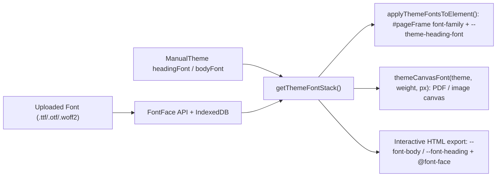

# Customizable Theme Fonts Design

Custom themes can set both colors and typography. Each theme has two font roles:

| Role | Theme field | Used for |
| --- | --- | --- |
| **Headings & Numbers** | `headingFont` | Step numbers, cover/divider/BOM titles, part counts, sub-step and callout counts |
| **Body & Labels** | `bodyFont` | Part names, footers & page numbers, captions, intro labels, badges below weight 800 |

## Curated Self-Hosted Font Catalog (Offline & Neocities Safe)

Built-in fonts are defined in `THEME_FONTS` in [`src/themes/customFonts.ts`](../src/themes/customFonts.ts) (re-exported from [`src/themes/customThemes.ts`](../src/themes/customThemes.ts)) and bundled as self-hosted WOFF2 files in `src/assets/fonts/` (declared in [`src/themeFonts.css`](../src/themeFonts.css) and [`src/index.css`](../src/index.css)). Every face renders identically across macOS, Windows, Linux, mobile, offline builds, and PDF exports.

| Category | ID | Face | Notes |
| --- | --- | --- | --- |
| **Sans & Geometric** | `public-sans` *(default)* | Public Sans | Clean neutral pressroom sans (variable 100–900) |
| | `outfit` | Outfit | Crisp manual geometric sans (variable 100–900) |
| | `plus-jakarta-sans` | Plus Jakarta Sans | Modern studio sans (variable 200–800) |
| | `rounded` *(legacy ID)* | Fredoka | Playful chunky rounded sans (variable 300–700) |
| | `nunito` | Nunito | Soft friendly rounded sans (variable 200–1000) |
| | `rubik` | Rubik | Rounded block geometric sans (variable 300–900) |
| | `system` | System Sans | Platform native UI font stack |
| **Technical & Sci-Fi** | `condensed` *(legacy ID)* | Barlow Condensed | Industrial condensed sans (500 / 700 / 800) |
| | `space-grotesk` | Space Grotesk | Geometric tech grotesque (variable 300–700) |
| | `chakra-petch` | Chakra Petch | Square-cornered mecha / sci-fi face (500 / 700) |
| | `mono` | JetBrains Mono | Technical blueprint monospace (variable 100–800) |
| **Editorial & Slab** | `serif` *(legacy ID)* | Fraunces | Warm expressive soft-serif (variable 100–900) |
| | `playfair-display` | Playfair Display | Collector high-contrast editorial serif (variable 400–900) |
| | `slab` *(legacy ID)* | Roboto Slab | Sturdy mechanical slab serif (variable 100–900) |
| | `bitter` | Bitter | Crisp contemporary slab serif (variable 100–900) |
| **Display & Playful** | `bungee` | Bungee | Blocky urban poster display |
| | `bangers` | Bangers | Classic comic-book action display |
| | `architects-daughter` | Architects Daughter | Architectural drafting hand-lettering |

Legacy IDs (`rounded`, `condensed`, `serif`, `slab`) are preserved so older saved themes and `.biwtheme` files automatically upgrade from OS fallback stacks to real bundled WOFF2 typefaces.

## Custom Uploaded Fonts (`.ttf`, `.otf`, `.woff2`, `.woff`)

Users can upload their own font files directly from the Style popover's **Typography** section:

- **Validation & Registration:** `parseUploadedFontFile()` checks the extension, enforces an 8 MB size cap, converts the file to a base64 `data:` URL, assigns a safe `uf_<id>` identifier and deterministic `BIW User <id>` CSS family name (preventing CSS injection), and verifies loadability via `new FontFace(...).load()` before adding it to `document.fonts`.
- **Persistence:** Uploaded fonts are persisted in IndexedDB under `customUploadedFonts` and hydrated on app startup via `hydrateCustomUploadedFonts()`.
- **Portable Sharing:**
  - `.biwtheme` exports (`serializeThemeExport()` / `serializeThemesPackExport()`) automatically embed any referenced custom uploaded fonts in an optional `customFonts` array (keeping `version: 1` backward-compatible). Importing a `.biwtheme` file restores and persists those fonts automatically.
  - `.biw` project exports embed referenced custom fonts in `customFonts` and restore them on project load.
  - Interactive 3D HTML exports emit sanitized `@font-face` rules for referenced custom uploaded fonts so standalone exports preserve the exact typography.

## Data Model & Compatibility

- `ManualTheme.headingFont?` / `ManualTheme.bodyFont?` accept any built-in `BuiltInThemeFontId` or custom uploaded font ID (`uf_[A-Za-z0-9_-]{3,48}`).
- `normalizeCustomTheme()` runs every value through `sanitizeThemeFontId()`. Unknown or malicious strings fall back to the base theme's font, then `public-sans`.
- If a theme references a custom `uf_*` font ID that has not been hydrated yet or was deleted, `getThemeFontOption()` safely falls back to `public-sans` without crashing or losing the stored ID during boot.

## Rendering Pipeline

- **Live page (DOM):** `applyThemeFontsToElement()` sets the body stack inline on `#pageFrame` and exposes the heading stack as `--theme-heading-font`. In `index.css`, `#pageFrame .font-extrabold, #pageFrame .font-black` (and the same classes in `.theme-card-preview`) use the heading variable.
- **Canvas (PDF / print / images):** Every `ctx.font` in `renderPageToJpegBytes()` and `drawRotationCueBadgeCanvas()` goes through `themeCanvasFont()`. Weights ≥ 800 use the heading font; lighter weights use the body font. Before drawing, `ensureThemeFontsLoaded()` awaits `document.fonts.load()` across weights `400/500/700/800/900` for bundled and uploaded families.

## Editor UI

The Style popover's **Typography** section features:
- Two live preview trigger cards (`#btnThemeHeadingFont`, `#btnThemeBodyFont`) displaying the active font name and specimen (`12 · 4×` / `2×4 Brick`) rendered in its actual typeface.
- An inline expandable **Visual Font Picker** (`#themeFontPickerPanel`) with instant search, category tabs (`All`, `Sans`, `Tech`, `Serif`, `Display`, `Yours`), live rendered specimens for every font, and one-click removal for uploaded custom fonts.
- An **Upload Font** button (`#btnUploadCustomFont`) supporting `.ttf`, `.otf`, `.woff2`, and `.woff` files.

## Future Work

- Optional font scale per role (e.g. step-number size multiplier).
- Curated one-click heading + body font pairing presets.
